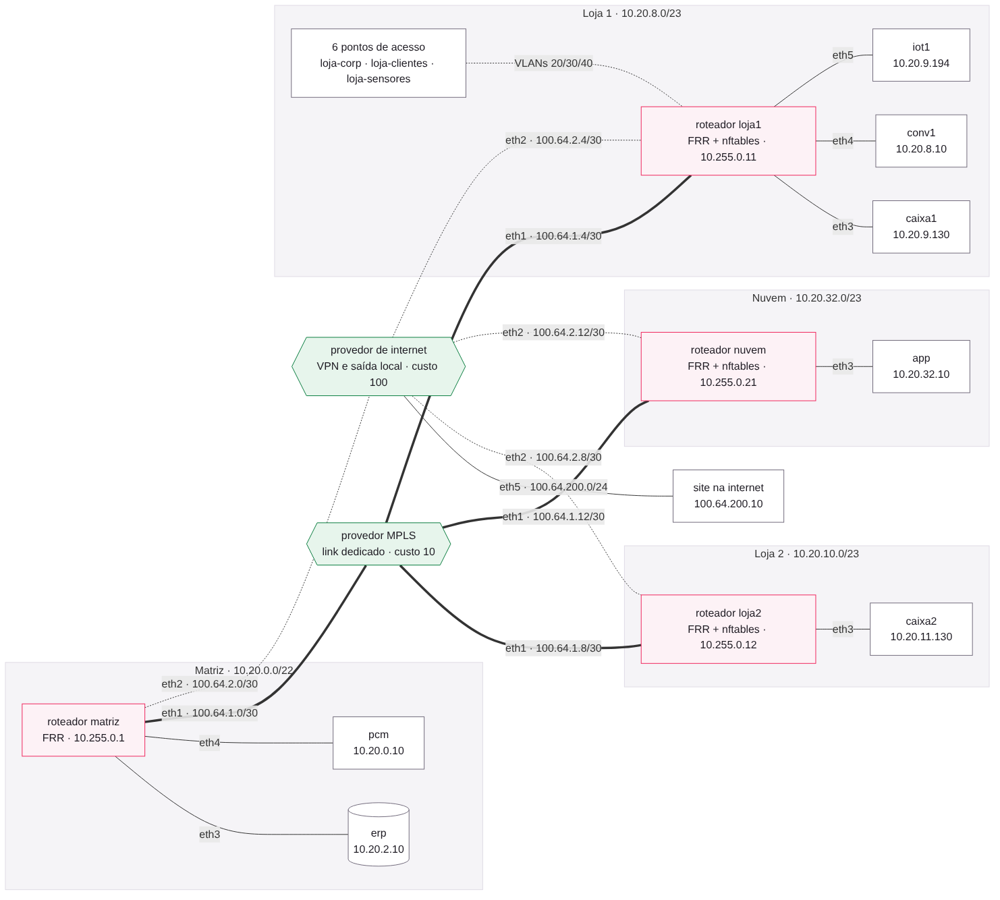
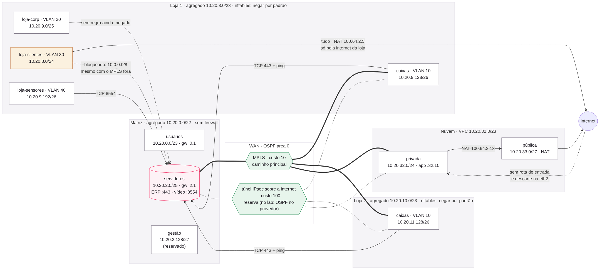

# Da matriz à nuvem · laboratório de Network Architect Solutions

- **Grupo:** João Victor Cazarini (RM 562543), Diego Bondezan (RM 562013), Guilherme Amaral (RM 562112, líder), Felipe Garcia (RM 563521), Diogo Weyne (RM 572347) · turma ESPX2
- **Onde a rede roda:** GitHub Codespaces, máquina de 2 núcleos, imagem do containerlab 0.68.0 (`.devcontainer/devcontainer.json`)
- **Agregados do plano:** matriz 10.20.0.0/22, loja 1 10.20.8.0/23, loja 2 10.20.10.0/23, nuvem 10.20.32.0/23 (dentro de 10.20.0.0/16)

A rede de uma varejista com matriz, duas lojas e nuvem, ligadas por um link dedicado (MPLS) e pela internet. Tudo está em arquivos: quem clona o repositório sobe a mesma rede.



## Como subir a rede

No terminal do Codespaces, a partir de um clone limpo:

```bash
cd rede
sudo containerlab deploy -t rede.clab.yml          # na primeira vez baixa as imagens (alguns minutos)
sleep 45                                            # tempo para o OSPF formar vizinhança
docker exec clab-rede-loja1 vtysh -c "show ip ospf neighbor"   # dois vizinhos em Full
docker exec clab-rede-caixa1 ping -c 3 10.20.2.10              # caixa da loja 1 -> ERP
```

Para gerar todas as evidências de uma vez (cerca de 15 minutos), da raiz do repositório:

```bash
./evidencias/coletar.sh        # ou ./evidencias/coletar.sh 4  para uma missão só
```

Para derrubar: `sudo containerlab destroy -t rede/rede.clab.yml`. Parem o Codespace ao terminar.

## Estrutura

| Pasta | O que tem |
|---|---|
| `enderecamento/` | `requisitos.csv`, `plano.csv` e o verificador |
| `rede/` | topologia `rede.clab.yml`, `daemons`, um `.conf` por roteador, regras `.nft` e `politica-caminhos.yaml` |
| `seguranca/` | `fluxos.md`, a matriz de fluxos permitidos |
| `semfio/` | `projeto.md`, SSIDs, VLANs, pontos de acesso e canais |
| `operacao/` | `monitora.py`, monitor com linha de base |
| `arquitetura/` | visões física e lógica (fonte `.mmd` em Mermaid e imagem `.png`) e a tabela de rotas da nuvem |
| `evidencias/` | `coletar.sh`, que roda os testes de todas as missões e grava as saídas aqui, e `mede_queda.py` |

## Peças da entrega

| Semana | Missão | Peça | Onde está e qual teste a comprova |
|---|---|---|---|
| 1 | 1 | Plano de endereçamento | `enderecamento/plano.csv`; o verificador responde OK, 13 segmentos em 4 agregados, 78% em uso (teste: `./evidencias/coletar.sh 1`) |
| 2 | 2 | Rede como código | `rede/rede.clab.yml`; 14 nós; loja 1 com dois vizinhos OSPF em Full; a mudança manual na loja 2 é desfeita pelo `deploy --reconfigure` (teste: `./evidencias/coletar.sh 2`) |
| 2 | 3 | Caminhos e redundância | custos 10 (MPLS) e 100 (internet) nos `.conf`; `rede/politica-caminhos.yaml`; queda da interface sem perda e falha silenciosa de 30 a 40 s (intervalo de morte do OSPF) (teste: `./evidencias/coletar.sh 3`) |
| 3 | 4 | Segmentação e firewall | `rede/loja1.nft`, `rede/loja2.nft` e `seguranca/fluxos.md`; 8 testes, 8 corretos, inclusive com o MPLS fora (teste: `./evidencias/coletar.sh 4`) |
| 3 | 5 | Nuvem híbrida | `rede/nuvem.nft`; a privada sai com NAT (200, e 000 sem ele), não é alcançada de fora e a matriz chega nela pela internet quando o link dedicado cai (teste: `./evidencias/coletar.sh 5`); `arquitetura/rotas-nuvem.md` |
| 4 | 6 | Projeto sem fio | `semfio/projeto.md`; 3 SSIDs em 3 VLANs; 6 pontos de acesso por loja; canais sem conflito entre vizinhos |
| 4 | 7 | Monitoração | `operacao/monitora.py`; alerta em poucos segundos com o MPLS degradado; sem degradação, nenhum alerta (teste: `./evidencias/coletar.sh 7`) |
| 5 | 8 | Desenho e README | `arquitetura/fisica.png` e `arquitetura/logica.png`, com as fontes `.mmd` |

## Decisões e respostas, missão a missão

### 1 · Endereçamento

Cada segmento tem 30% de folga sobre os hosts pedidos, e os prefixos foram alocados do maior para o menor dentro do agregado de cada local, para não abrir buracos de alinhamento. Os usuários da matriz pedem 200 hosts; com a folga, 260, que não cabem em um /24 (254 úteis), então ficaram em um /23. Cada loja cabe exatamente em um /23: 256 + 128 + 64 + 64 = 512.

| Local | Segmento | Hosts + 30% | Prefixo | Gateway |
|---|---|---|---|---|
| matriz | usuarios | 260 | 10.20.0.0/23 | 10.20.0.1 |
| matriz | servidores | 65 | 10.20.2.0/25 | 10.20.2.1 |
| matriz | gestao | 26 | 10.20.2.128/27 | 10.20.2.129 |
| loja 1 | convidados | 156 | 10.20.8.0/24 | 10.20.8.1 |
| loja 1 | wifi-corp | 78 | 10.20.9.0/25 | 10.20.9.1 |
| loja 1 | caixas | 52 | 10.20.9.128/26 | 10.20.9.129 |
| loja 1 | iot | 33 | 10.20.9.192/26 | 10.20.9.193 |
| loja 2 | convidados | 156 | 10.20.10.0/24 | 10.20.10.1 |
| loja 2 | wifi-corp | 78 | 10.20.11.0/25 | 10.20.11.1 |
| loja 2 | caixas | 52 | 10.20.11.128/26 | 10.20.11.129 |
| loja 2 | iot | 33 | 10.20.11.192/26 | 10.20.11.193 |
| nuvem | privada | 130 | 10.20.32.0/24 | 10.20.32.1 |
| nuvem | publica | 26 | 10.20.33.0/27 | 10.20.33.1 |

**Convenção de gateway:** o primeiro endereço útil de cada segmento é o do roteador. Hosts fixos do laboratório: ERP 10.20.2.10, pcm 10.20.0.10, caixa1 10.20.9.130, conv1 10.20.8.10, iot1 10.20.9.194, caixa2 10.20.11.130, app 10.20.32.10.

### 2 · A rede como código

**O que aconteceu com a mudança manual, e por quê.** Mudamos pelo `vtysh` da loja 2 o endereço da interface dos caixas de 10.20.11.129/26 para 10.20.11.1/26. Depois do `deploy --reconfigure`, o endereço voltou a 10.20.11.129/26. O containerlab recriou o nó a partir dos arquivos: o `loja2.conf` montado em `/etc/frr/frr.conf` é a fonte da verdade, e a configuração em execução não é salva em lugar nenhum. A mudança manual não tinha registro, revisão nem motivo, e deixaria o caixa 2 sem gateway (ele aponta para .129). Mudança que vale passa pelo Git, por pull request.

Os provedores (`mpls.conf`, `inet.conf`) e o `daemons` são os do professor, sem alteração.

### 3 · Caminhos e redundância

Custo 10 nas interfaces do MPLS e 100 nas da internet, nos quatro roteadores. Do caixa da loja 1 ao ERP: pelo MPLS 10 + 10 + 10 = 30; pela internet 100 + 100 + 10 = 210. O OSPF instala o de 30, e o de 210 assume sozinho quando o primeiro some. As interfaces de rede local também têm custo 10 explícito, para a conta não depender da velocidade que a interface informa.

- **Queda da interface:** o roteador percebe na hora e troca de caminho; o ping contínuo não perde resposta. O traceroute passa a mostrar 100.64.2.6 e 100.64.2.1.
- **Falha silenciosa:** o link continua aceso e nada chega. O OSPF só desiste do vizinho no intervalo de morte (40 s, hellos a cada 10 s), então a loja fica de 30 a 40 s sem resposta. O BFD reduziria isso para menos de 1 s.

A política por aplicação está em `rede/politica-caminhos.yaml`: caixa, ERP e vídeo preferem o MPLS com limites diferentes de latência e perda; o backup prefere a internet; os convidados saem pela internet da própria loja.

### 4 · Segmentação e firewall

Política padrão `drop` no encaminhamento, uma regra por fluxo (`seguranca/fluxos.md`) e NAT dos convidados. O ponto delicado: a regra que libera o convidado para a internet é "sai pela eth2". Se o MPLS cair, a rota para o ERP também passa a sair pela eth2, e o convidado chegaria ao ERP. Testamos isso sem a regra de descarte e o convidado recebeu 200 do ERP. Por isso o descarte de 10.0.0.0/8 para os convidados vem antes da saída para a internet. Também protegemos o próprio roteador: convidados e IoT só falam com o próprio gateway (cadeia `input`).

### 5 · Nuvem híbrida

**Por que sem NAT a aplicação não abre o site.** O pacote sai com origem 10.20.32.10, um endereço privado (RFC 1918). Ele chega ao site, mas a resposta para 10.20.32.10 não tem caminho de volta: na internet ninguém tem rota para 10.x. Com o NAT, o roteador da nuvem troca a origem pelo endereço público dele (100.64.2.13), a resposta volta para esse endereço e o roteador desfaz a troca.

**Isolamento.** Mesmo quando alguém de fora ganha uma rota para 10.20.32.0/24, nada responde: o `nuvem.nft` descarta o que chega pela internet para a privada, exceto o que vem da própria empresa (o caminho de reserva). Na vida real, esse critério seria "só o que chega pelo túnel IPsec"; no laboratório, o túnel é simulado pelo OSPF no provedor.

A tabela de rotas da privada, como no console de uma nuvem pública, está em `arquitetura/rotas-nuvem.md`.

### 6 · Projeto sem fio

Três SSIDs em três VLANs (20 corporativo, 30 clientes, 40 sensores), cada uma em uma sub-rede do plano. Seis pontos de acesso por loja: 4 pela área, 6 pela capacidade, vale o maior. Em 2,4 GHz, canais 1, 6 e 11 alternados entre as fileiras; em 5 GHz, um canal por ponto. Detalhes em `semfio/projeto.md`.

### 7 · Operação

O `monitora.py` mede o caminho do caixa até o ERP a cada segundo. A linha de base usa média e desvio das últimas 30 medições boas e alerta acima de média + 3 desvios (piso de 2 ms) ou com 3 perdas em 10. Medições que alertam não entram na linha de base, para o "normal" não aprender a degradação. Com o MPLS degradado, o monitor alerta e o traceroute continua passando por 100.64.1.6: o OSPF não troca de caminho porque o link está de pé. `--fechar-ciclo` (extra) sobe o custo OSPF da eth1 da loja 1 para 500 depois de 3 alertas seguidos, e o tráfego vai para a internet.

### 8 · Visões



## Tempos esperados

| Medida | Esperado | Por quê |
|---|---|---|
| Queda da interface do MPLS da loja 1 | 0 s sem resposta | o roteador percebe a interface caída na hora e troca para a internet |
| Falha silenciosa no MPLS da loja 1 | 30 a 40 s sem resposta | o OSPF só desiste do vizinho no intervalo de morte (40 s, hellos a cada 10 s) |
| Tempo até o alerta do monitor | poucos segundos | a primeira medição acima de média + 3 desvios já alerta |

O `./evidencias/coletar.sh` mede os três e grava a saída em `evidencias/`.
